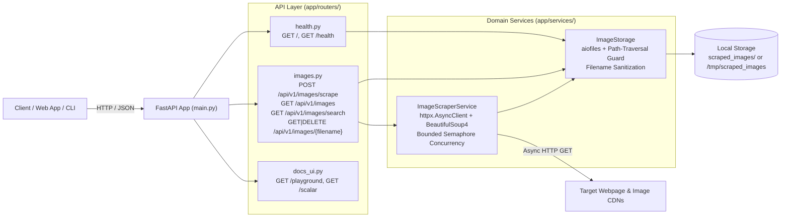

# Image Scraping System Server

A unified, asynchronous **FastAPI** service for scraping images from webpages, storing them safely on disk, searching stored assets by filename, and serving them over HTTP.

> **Consolidation Note:** Previously split across two overlapping services (`scraper_server` and `image_search_server`), this repository now provides a single cohesive service with unified configuration, concurrent async downloads, and path-traversal protection. See [ADR-001](./docs/adr/ADR-001-consolidate-scraper-and-image-search-services.md).

---

## Architecture Overview



---

## Quick Start

### Prerequisites
- **Python** 3.10+ (tested on 3.12 and 3.13)
- `pip`

### 1. Clone & Configure Environment
```bash
git clone https://github.com/digitalterrene/image-scraping-system-server.git
cd image-scraping-system-server
cp .env.example .env
```

### 2. Install Dependencies
```bash
python -m venv .venv
# Windows (PowerShell): .\.venv\Scripts\Activate.ps1
# macOS / Linux:        source .venv/bin/activate
pip install -r requirements.txt
```

### 3. Run the Server
```bash
python -m uvicorn main:app --reload
```

### Interactive API Docs & In-Browser Testing (No Postman / Thunder Client Needed)
Once the server is running, open any of these built-in developer tools:
- **Visual API Playground:** `http://127.0.0.1:8000/playground` *(scrape URLs, preview image thumbnails, search, delete, and inspect live JSON responses)*
- **Scalar API Reference:** `http://127.0.0.1:8000/scalar` *(modern interactive API tester with generated `curl`, Python, and JS snippets)*
- **Swagger UI:** `http://127.0.0.1:8000/docs` *(OpenAPI "Try it out" explorer)*
- **ReDoc:** `http://127.0.0.1:8000/redoc`

For a step-by-step usage guide with `curl`, PowerShell, Python, and JavaScript examples, see the **[API Walkthrough Guide](./docs/guides/api-walkthrough.md)**.

---

## API Endpoints

| Method | Path | Description |
|---|---|---|
| `GET` | `/` | Service discovery, version, and route index |
| `GET` | `/health` | Health check with storage directory and image count |
| `POST` | `/api/v1/images/scrape` | Scrape `` tags from a target webpage URL and save valid images |
| `GET` | `/api/v1/images` | List all stored images (supports optional `?query=` filter) |
| `GET` | `/api/v1/images/search` | Search stored images by case-insensitive filename substring (`?query=...`) |
| `GET` | `/api/v1/images/{filename}` | Serve a stored image file safely |
| `DELETE` | `/api/v1/images/{filename}` | Delete a stored image file |

See [API Specification](./docs/architecture/api-specification.md) for full request/response schemas and `curl` examples.

---

## Environment Variables

All configuration is centralized in [`app/config.py`](./app/config.py) and documented in [`.env.example`](./.env.example):

| Variable | Default | Description |
|---|---|---|
| `SCRAPED_IMAGES_DIR` | `scraped_images` (`/tmp/scraped_images` on Vercel) | Directory used to store scraped images |
| `BASE_URL` | *(derived from request)* | Optional public URL prefix for returned image links |
| `REQUEST_TIMEOUT_SECONDS` | `15.0` | Timeout (seconds) for upstream webpage and image fetches |
| `MAX_CONCURRENT_DOWNLOADS` | `10` | Max simultaneous image downloads per scrape request |
| `MAX_IMAGE_SIZE_BYTES` | `10485760` (10 MiB) | Maximum allowed file size per downloaded image |
| `MAX_IMAGES_PER_SCRAPE` | `50` | Cap on unique image URLs processed per scrape request |
| `CORS_ORIGINS` | `*` | Comma-separated list of allowed CORS origins |
| `SCRAPER_USER_AGENT` | `ImageScrapingSystem/2.0 (...)` | `User-Agent` header sent to target websites |

---

## Project Structure

```text
image-scraping-system-server/
├── main.py                              # ASGI entrypoint (Uvicorn & Vercel)
├── app/
│   ├── config.py                        # Immutable Settings loaded from env
│   ├── schemas.py                       # Pydantic v2 request/response DTOs
│   ├── routers/
│   │   ├── docs_ui.py                   # GET /playground, GET /scalar
│   │   ├── health.py                    # GET /, GET /health
│   │   └── images.py                    # /api/v1/images/* endpoints
│   └── services/
│       ├── scraper.py                   # Async HTML parsing & concurrent downloads
│       └── storage.py                   # Safe local storage & path-traversal guard
├── tests/                               # Unit & end-to-end API tests
├── docs/
│   ├── git-standards.md                 # Tier 1: Git & Conventional Commit standards
│   ├── guides/                          # Developer walkthroughs & usage guides
│   ├── architecture/                    # Tier 2: System design, API, data model, security
│   ├── adr/                             # Tier 3: Architecture Decision Records
│   └── runbooks/                        # Tier 4: Deployment & incident runbooks
├── .github/                             # CI workflow, PR & Issue templates
├── CHANGELOG.md                         # Release history & v2.0 enhancements
├── .env.example                         # Environment configuration template
├── requirements.txt                     # Minimal production Python dependencies
└── vercel.json                          # Vercel Python serverless configuration
```

---

## Verification & Testing

Run the full unit and API test suite:
```bash
python -m unittest discover -s tests -v
```

Run the repository hygiene audit:
```bash
node .agents/skills/senior-repo-standards/scripts/audit-hygiene.js
```

---

## Documentation Architecture

This repository follows the **4-Tier Documentation Architecture**:

| Tier | Location | Contents |
|---|---|---|
| **Tier 1: Governance** | Root (`/`) | [README](./README.md), [CHANGELOG](./CHANGELOG.md), [CONTRIBUTING](./CONTRIBUTING.md), [SECURITY](./SECURITY.md), [LICENSE](./LICENSE), [Git Standards](./docs/git-standards.md) |
| **Developer Guides** | [`docs/guides/`](./docs/guides/) | [API Walkthrough & Interactive Testing Guide](./docs/guides/api-walkthrough.md) |
| **Tier 2: Architecture** | [`docs/architecture/`](./docs/architecture/) | [System Design](./docs/architecture/system-design.md), [API Spec](./docs/architecture/api-specification.md), [Data Model](./docs/architecture/data-model.md), [Security](./docs/architecture/security-and-rbac.md) |
| **Tier 3: Decisions** | [`docs/adr/`](./docs/adr/) | [ADR Index](./docs/adr/README.md), [ADR-001](./docs/adr/ADR-001-consolidate-scraper-and-image-search-services.md), [ADR-002](./docs/adr/ADR-002-async-http-scraping-and-storage-abstraction.md) |
| **Tier 4: Runbooks** | [`docs/runbooks/`](./docs/runbooks/) | [Deployment Verification](./docs/runbooks/deployment-verification.md), [Incident Response](./docs/runbooks/incident-response.md) |

---

## Tech Stack

| Layer | Technology |
|---|---|
| Web Framework | [FastAPI](https://fastapi.tiangolo.com/) + [Pydantic v2](https://docs.pydantic.dev/) |
| ASGI Server | [Uvicorn](https://www.uvicorn.org/) |
| Async HTTP Client | [HTTPX](https://www.python-httpx.org/) |
| Async File I/O | [aiofiles](https://github.com/Tinche/aiofiles) |
| HTML Parsing | [BeautifulSoup 4](https://www.crummy.com/software/BeautifulSoup/) |
| Serverless Runtime | [Vercel Python](https://vercel.com/docs/functions/runtimes/python) (+ optional [Mangum](https://mangum.io/)) |
