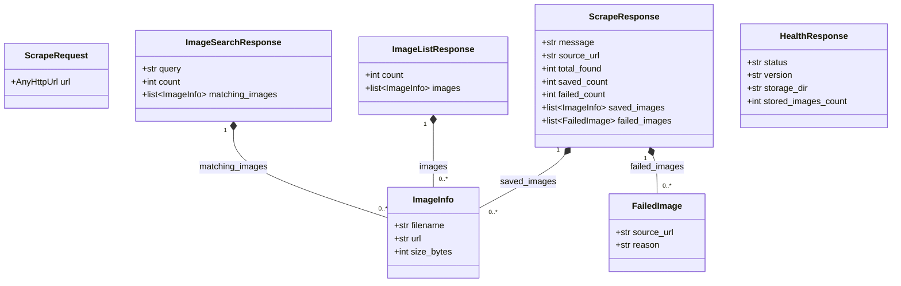

# Data Models & Storage Architecture

*Status*: Living Architecture Specification  
*Version*: 2.0.0

---

## 1. Domain & DTO Model

The service is stateless at the database layer and models all API contracts via **Pydantic v2** schemas in [`app/schemas.py`](../../app/schemas.py) and domain dataclasses in [`app/services/scraper.py`](../../app/services/scraper.py).



---

## 2. Filesystem Storage Layout

Images are stored flat inside `SCRAPED_IMAGES_DIR` (default `scraped_images/`, or `/tmp/scraped_images` on Vercel):

```text
scraped_images/
├── .gitkeep              # Excluded from API listings (dotfile guard)
├── hero_banner.png       # Sanitized filename from URL path
└── image_2.webp          # Fallback stem + extension inferred from Content-Type
```

### Filename Sanitization Rules (`ImageStorage.sanitize_filename`)
1. Directory segments are stripped via `Path(raw_name).name`.
2. Characters outside `[a-zA-Z0-9._-]` are replaced with `_`.
3. Consecutive dots (`..`) are collapsed to `.` and leading/trailing dots or underscores are stripped.
4. If no extension is present, one is inferred from the HTTP `Content-Type` header (`image/jpeg` -> `.jpg`, `image/png` -> `.png`, `image/webp` -> `.webp`, etc.).
5. Filenames are capped at 180 characters to remain portable across Windows, macOS, and Linux filesystems.

---

## 3. Future Persistence Evolution

Because all filesystem operations are encapsulated behind `ImageStorage`, migrating to durable cloud object storage (e.g., Cloudflare R2, AWS S3, or Google Cloud Storage) + metadata indexing (PostgreSQL / SQLite) requires only swapping the storage provider injected by `get_storage()` in `app/routers/images.py`, with zero changes to API schemas or scraping logic.
