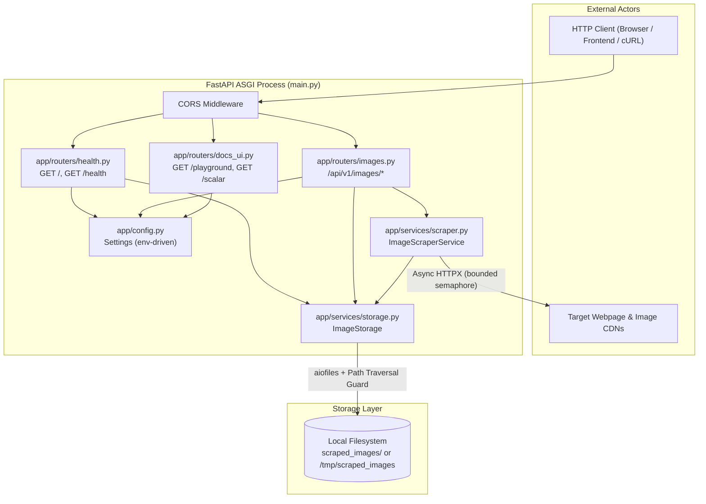
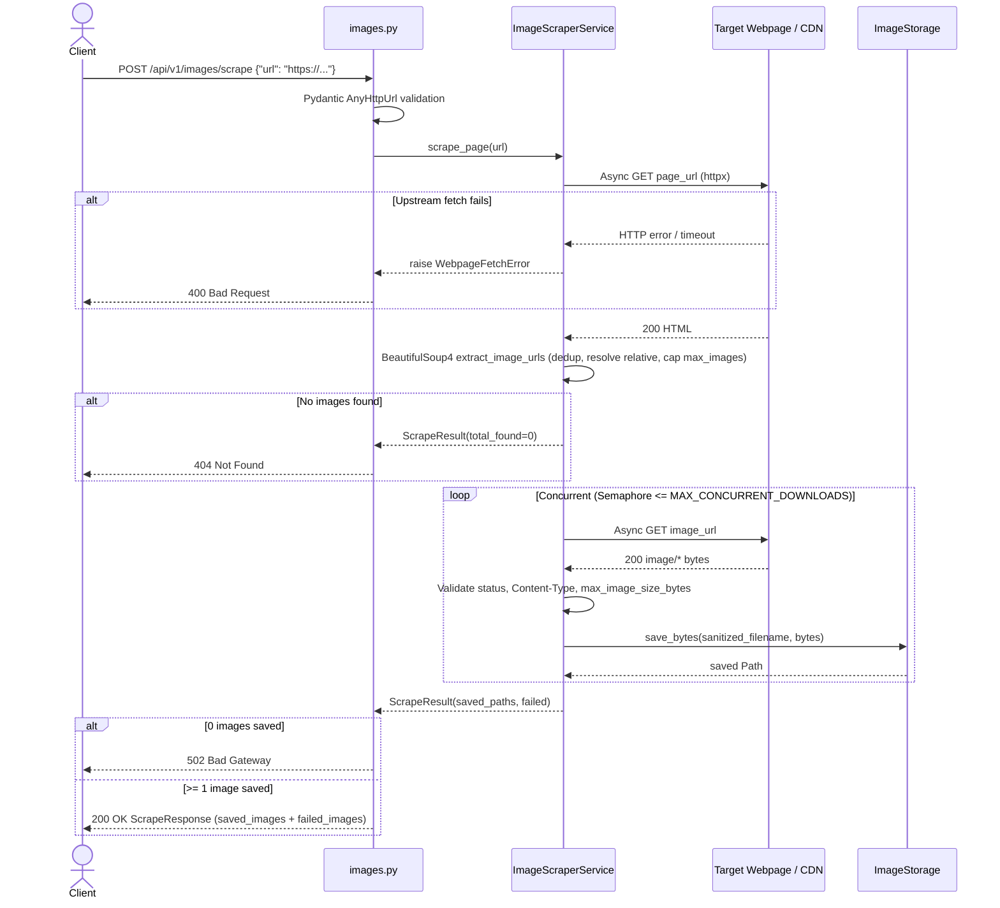
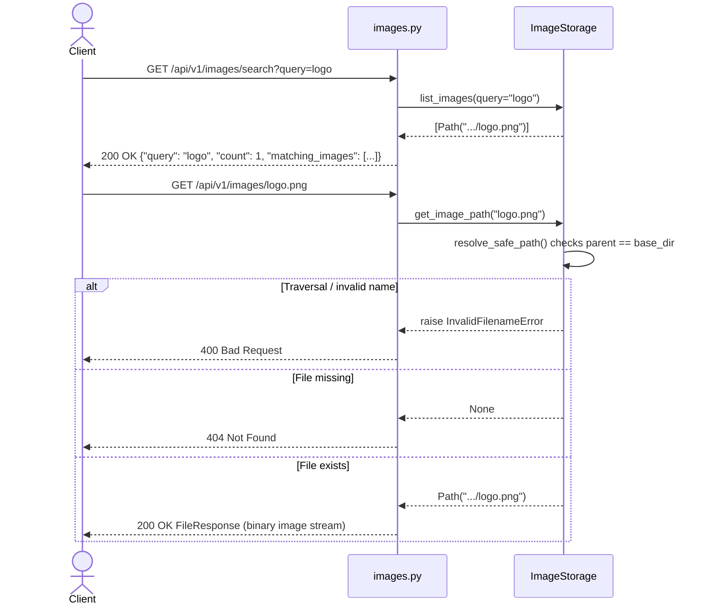

# System Design & Component Topology

*Status*: Living Architecture Specification  
*Version*: 2.0.0

---

## 1. System Overview

The **Image Scraping System Server** is a single, unified FastAPI service responsible for:
1. Fetching public webpages and extracting `` asset URLs asynchronously.
2. Downloading valid image payloads concurrently with bounded concurrency and size limits.
3. Persisting images to a sandboxed local storage directory with strict filename sanitization.
4. Listing, searching (case-insensitive substring match), serving, and deleting stored images over RESTful HTTP endpoints.

---

## 2. Component Topology

---

## 3. Core Request Flows

### 3.1 Webpage Image Scraping (`POST /api/v1/images/scrape`)

### 3.2 Image Search & Retrieval (`GET /api/v1/images/search` & `GET /api/v1/images/{filename}`)

---

## 4. Concurrency & Deployment Architecture

- **Non-Blocking I/O**: All webpage fetches, image downloads, and file writes use `httpx.AsyncClient` and `aiofiles`—eliminating the blocking `requests.get()` bottleneck present in the legacy `scraper_server`.
- **Bounded Concurrency**: Downloads are throttled with `asyncio.Semaphore(MAX_CONCURRENT_DOWNLOADS)` (default `10`) to avoid exhausting sockets or triggering upstream rate limits.
- **Serverless Compatibility (Vercel)**:
  - `main.py` exports `app` directly for `@vercel/python` ASGI execution, plus an optional `handler = Mangum(app)` for AWS Lambda adapters.
  - When `VERCEL` is set in the environment and `SCRAPED_IMAGES_DIR` is unset, `app/config.py` automatically targets `/tmp/scraped_images` because the Vercel deployment bundle filesystem is read-only.
  - **Note on Ephemeral Storage**: Serverless `/tmp` storage is ephemeral across cold starts. For durable multi-instance production deployments, implement an S3/R2/GCS storage adapter behind the `ImageStorage` interface (see [ADR-002](../adr/ADR-002-async-http-scraping-and-storage-abstraction.md)).
