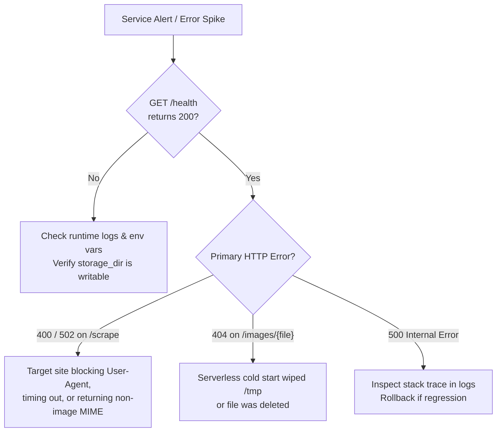

# Incident Response Runbook

Triage and remediation procedures for common production issues in **Image Scraping System Server**.

---

## 1. Triage Flowchart

---

## 2. Common Failure Modes & Mitigations

### A. Read-Only Filesystem Errors on Serverless Platforms
- **Symptom**: `OSError: [Errno 30] Read-only file system` on startup or scrape.
- **Cause**: `SCRAPED_IMAGES_DIR` points to a non-writable deployment directory.
- **Resolution**: Unset `SCRAPED_IMAGES_DIR` on Vercel (auto-defaults to `/tmp/scraped_images`) or explicitly set `SCRAPED_IMAGES_DIR=/tmp/scraped_images`.

### B. High Failure Rate on `POST /api/v1/images/scrape` (HTTP 400 / 502)
- **Symptom**: `failed_count` spikes or `502 Bad Gateway` returned.
- **Cause**: Target site rate-limits requests, requires a browser/JS rendering, or returns slow responses exceeding `REQUEST_TIMEOUT_SECONDS`.
- **Resolution**:
  1. Check `failed_images[].reason` in the response payload.
  2. Increase `REQUEST_TIMEOUT_SECONDS` (e.g., `25.0`) or reduce `MAX_CONCURRENT_DOWNLOADS` (e.g., `5`).
  3. Adjust `SCRAPER_USER_AGENT` if needed.

### C. Missing Images After Serverless Cold Start
- **Symptom**: Previously scraped images return `404 Not Found` on `GET /api/v1/images/{filename}`.
- **Cause**: Serverless `/tmp` storage is ephemeral and isolated per container instance.
- **Resolution**: For durable persistence across instances, migrate `ImageStorage` to an external object store (S3 / Cloudflare R2 / GCS).
